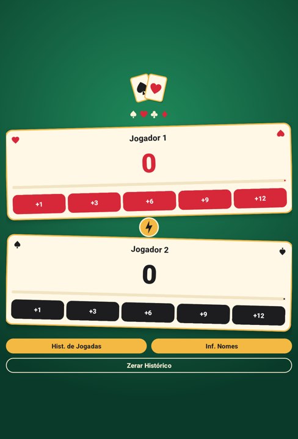
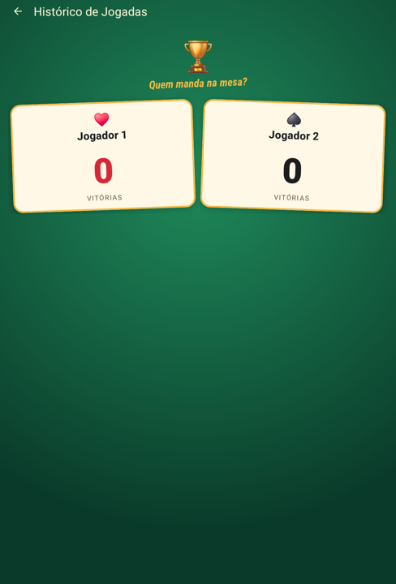
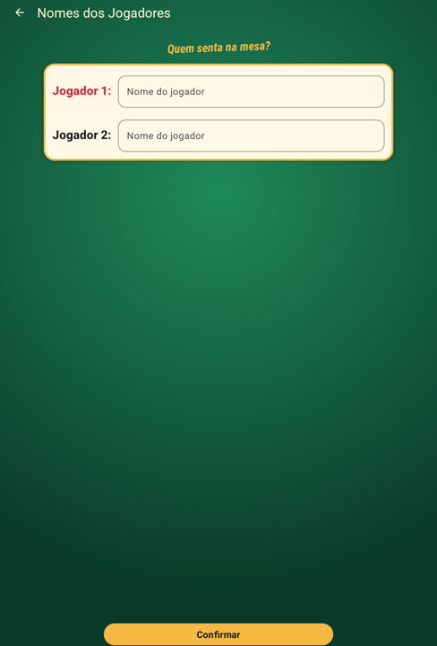

# Marca Truco

Aplicativo Android para marcar a pontuação de partidas de **Truco** entre dois jogadores. Ele registra os pontos de cada mão, identifica o vencedor ao chegar a 12 pontos, mantém o histórico de vitórias e permite personalizar o nome dos jogadores.

Projeto desenvolvido como trabalho final da disciplina de Android (Componentes Visuais Básicos, Tratamento de Eventos e Troca de Telas) da Especialização em Programação para Dispositivos Móveis da UTFPR, Campus Pato Branco.

<p align="center">
  
  
  
</p>

## Funcionalidades

- **Placar**: botões `+1`, `+3`, `+6`, `+9` e `+12` para cada jogador.
- **Vitória automática**: ao atingir 12 pontos ou mais, o jogador vence a partida, um Toast anuncia o vencedor, a pontuação dos dois é zerada e a vitória é contabilizada.
- **Histórico de jogadas**: tela com o nome de cada jogador e a quantidade de partidas vencidas desde o último reinício.
- **Informar nomes**: tela com dois campos de texto para personalizar o nome dos jogadores; os nomes confirmados aparecem na tela principal.
- **Zerar histórico**: volta pontuação, vitórias e nomes aos valores iniciais e exibe um Toast de confirmação.
- **Rotação de tela**: nenhum dado é perdido ao girar o aparelho.
- **Layout responsivo**: versão própria para paisagem, com as cartas lado a lado.
- **Proteção contra duplo clique**: toques repetidos em menos de 600 ms são ignorados.
- **Idiomas**: português (padrão), inglês e espanhol.

## Requisitos

| Item | Versão |
|---|---|
| Android mínimo | 13 (API 33) |
| Android alvo / compilação | API 37 |
| Android Gradle Plugin | 9.5.1 |
| Gradle | 9.6.0 |
| Java | 11 |

## Como executar

1. Abra a pasta do projeto no Android Studio.
2. Aguarde a sincronização do Gradle.
3. Conecte um aparelho (ou inicie um emulador) com Android 13 ou superior.
4. Execute a configuração **app**.

Pela linha de comando:

```bash
./gradlew installDebug
```

## Testes

```bash
# Testes de unidade (rodam no computador)
./gradlew testDebugUnitTest

# Testes de interface com Espresso (precisam de aparelho ou emulador conectado)
./gradlew connectedDebugAndroidTest
```

São 20 testes de unidade (regras do jogo e anti duplo clique) e 23 testes de interface cobrindo as três telas.

## Estrutura

```
app/src/main/java/com/miller/oliveira/marcatruco/
├── MainActivity.kt          # Tela principal: placar e navegação
├── PlayHistoryActivity.kt   # Tela de histórico de vitórias
├── ProvideNamesActivity.kt  # Tela para informar os nomes
├── TrucoGame.kt             # Regras do jogo (Kotlin puro, sem Android)
├── ClickThrottle.kt         # Lógica do anti duplo clique
├── IntentKeys.kt            # Chaves dos dados trocados entre telas
└── ViewExtensions.kt        # Extensões de View reutilizadas pelas telas
```

## Documentação

A documentação completa, com o funcionamento de cada tela, a arquitetura, o fluxo de dados entre as telas e a relação com os requisitos do trabalho, está em [`docs/DOCUMENTACAO.md`](docs/DOCUMENTACAO.md).

## Autor

**Miller César de Oliveira**
