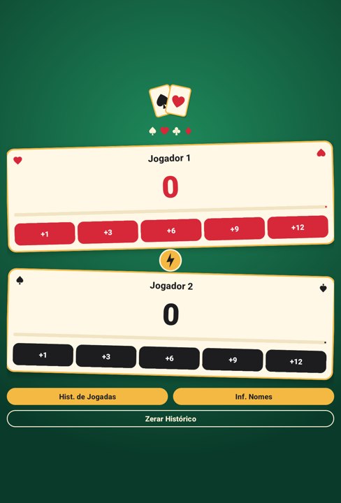
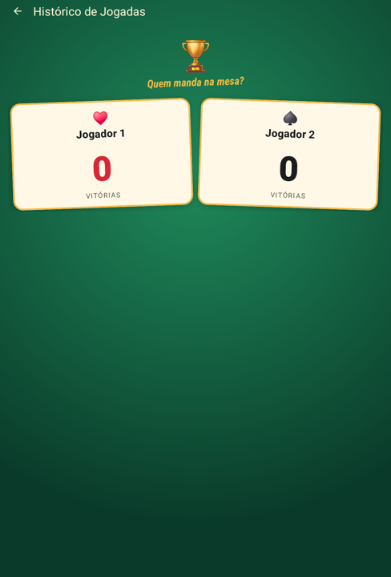
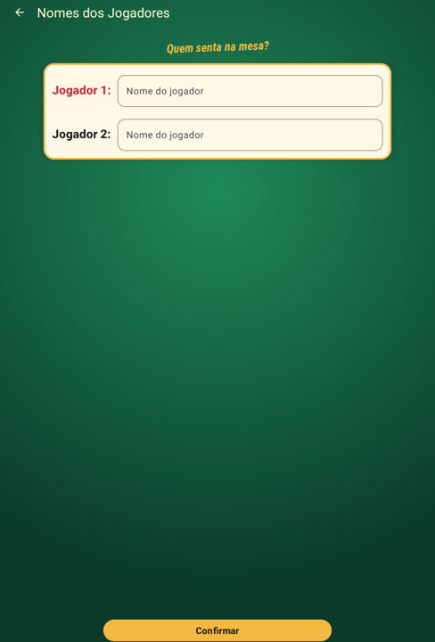
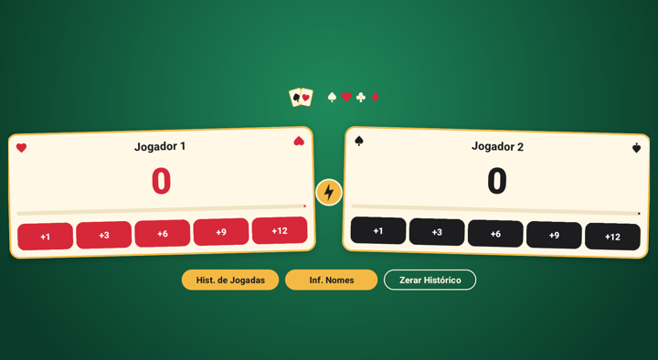
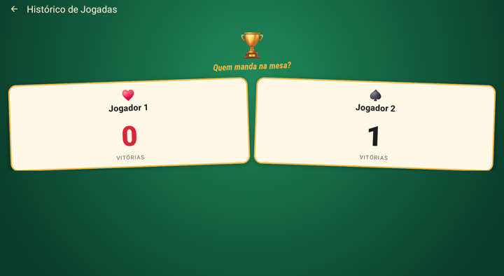

# Documentação do Projeto — Marca Truco

**Autor:** Miller César de Oliveira
**Instituição:** Universidade Tecnológica Federal do Paraná (UTFPR), Campus Pato Branco
**Curso:** Especialização em Programação para Dispositivos Móveis
**Disciplina:** Android: Componentes Visuais Básicos, Tratamento de Eventos e Troca de Telas

---

## Sumário

1. [Visão geral](#1-visão-geral)
2. [Telas do aplicativo](#2-telas-do-aplicativo)
3. [Regras de pontuação](#3-regras-de-pontuação)
4. [Arquitetura](#4-arquitetura)
5. [Comunicação entre as telas](#5-comunicação-entre-as-telas)
6. [Preservação do estado na rotação](#6-preservação-do-estado-na-rotação)
7. [Proteção contra duplo clique e toque simultâneo](#7-proteção-contra-duplo-clique-e-toque-simultâneo)
8. [Interface visual](#8-interface-visual)
9. [Internacionalização](#9-internacionalização)
10. [Testes automatizados](#10-testes-automatizados)
11. [Atendimento aos requisitos do trabalho](#11-atendimento-aos-requisitos-do-trabalho)
12. [Como compilar e executar](#12-como-compilar-e-executar)

---

## 1. Visão geral

O **Marca Truco** é um marcador de pontos para partidas de Truco entre dois jogadores. A cada mão, o usuário informa quantos pontos o vencedor da mão ganhou (1, 3, 6, 9 ou 12). Quando um jogador chega a 12 pontos, ele vence a partida, e o aplicativo contabiliza a vitória e prepara o placar para a próxima partida.

O aplicativo é composto de três telas:

| Tela | Classe | Função |
|---|---|---|
| Principal | `MainActivity` | Exibe o placar, recebe os pontos e dá acesso às demais telas |
| Histórico de Jogadas | `PlayHistoryActivity` | Mostra quantas partidas cada jogador venceu |
| Nomes dos Jogadores | `ProvideNamesActivity` | Permite personalizar o nome dos dois jogadores |

Todos os dados ficam em memória enquanto o aplicativo está aberto. Nada é gravado no armazenamento do aparelho.

---

## 2. Telas do aplicativo

### 2.1 Tela principal

<p align="center">
  
</p>

Cada jogador é representado por uma carta, que contém:

- **Nome do jogador** (`player_one_title` / `player_two_title`);
- **Pontuação atual** (`player_one_current_value` / `player_two_value`), em destaque e em negrito;
- **Barra de progresso** até 12 pontos;
- **Cinco botões de pontuação**: `+1`, `+3`, `+6`, `+9` e `+12`.

Na parte de baixo ficam os três botões de navegação e controle:

| Botão | Ação |
|---|---|
| **Hist. de Jogadas** | Abre a tela de histórico |
| **Inf. Nomes** | Abre a tela para informar os nomes |
| **Zerar Histórico** | Volta pontos, vitórias e nomes aos valores iniciais e exibe o Toast "Histórico zerado!" |

A tela é formada por **4 componentes TextView** (nome e pontuação de cada jogador) e **13 botões**. Os elementos decorativos (naipes, logotipo e o selo entre as cartas) são imagens vetoriais (`ImageView`), não textos.

Sempre que a pontuação muda, o número faz uma pequena animação de "pulo" e a barra de progresso avança.

### 2.2 Histórico de Jogadas

<p align="center">
  
</p>

Exibe o nome de cada jogador e a quantidade de partidas vencidas desde o último reinício. A tela recebe esses dados da tela principal no momento em que é aberta. O botão de voltar da barra superior (ou o botão voltar do sistema) retorna para a tela principal.

### 2.3 Nomes dos Jogadores

<p align="center">
  
</p>

Contém os rótulos **"Jogador 1:"** e **"Jogador 2:"**, dois campos de texto (`EditText`) e o botão **Confirmar**.

- Ao tocar em **Confirmar**, os nomes digitados são enviados para a tela principal, que atualiza as cartas.
- Espaços no início e no fim do nome são removidos.
- Um campo deixado em branco mantém o nome atual daquele jogador. Assim é possível alterar só um dos nomes.
- Ao voltar sem confirmar, nenhum nome é alterado.

### 2.4 Modo paisagem

<p align="center">
  
</p>

Em paisagem, a tela principal usa um layout próprio (`layout-land/activity_main.xml`), com as duas cartas lado a lado e os botões de ação numa única linha centralizada. Os dois layouts têm exatamente os mesmos componentes e identificadores, então o código da tela é o mesmo nas duas orientações.

<p align="center">
  
</p>

Nas telas de histórico e de nomes, o conteúdo pode ser rolado, e a largura do cartão e do botão Confirmar é limitada em telas largas.

---

## 3. Regras de pontuação

As regras ficam na classe `TrucoGame` (`TrucoGame.kt`), escrita em Kotlin puro, sem dependência do Android. Isso permite testá-la diretamente no computador.

```kotlin
class Player(
    val defaultName: String,
    var name: String = defaultName,
    var points: Int = 0,
    var victories: Int = 0,
)
```

| Operação | Comportamento |
|---|---|
| `addPoints(player, points)` | Soma os pontos ao jogador. Se ele chegar a **12 ou mais**, ganha uma vitória, os pontos **dos dois** jogadores são zerados e o vencedor é retornado. Caso contrário, retorna `null`. |
| `resetPoints()` | Zera os pontos dos dois jogadores e mantém as vitórias. |
| `restartHistory()` | Zera pontos e vitórias e restaura o nome padrão dos dois jogadores. |
| `rename(player, name)` | Troca o nome, removendo espaços nas pontas. Nomes vazios ou só com espaços são ignorados. |

Também há validações de segurança: `addPoints` recusa pontos menores ou iguais a zero e jogadores que não pertencem à partida.

Fluxo de uma jogada:

```
Toque em "+3" do Jogador 1
        │
        ▼
TrucoGame.addPoints(jogador1, 3)
        │
        ├── pontos < 12 ──► atualiza o placar na tela
        │
        └── pontos ≥ 12 ──► vitória +1
                            zera os pontos dos dois
                            Toast "<nome> venceu!"
                            atualiza o placar na tela
```

---

## 4. Arquitetura

```
app/src/main/
├── java/com/miller/oliveira/marcatruco/
│   ├── MainActivity.kt           # Tela principal
│   ├── PlayHistoryActivity.kt    # Tela de histórico
│   ├── ProvideNamesActivity.kt   # Tela de nomes
│   ├── SingleTouchActivity.kt    # Base das telas: bloqueia toque simultâneo
│   ├── TrucoGame.kt              # Player + regras do jogo
│   ├── ClickThrottle.kt          # Intervalo mínimo entre cliques
│   ├── IntentKeys.kt             # Chaves dos extras das Intents
│   └── ViewExtensions.kt         # Extensões de View compartilhadas
└── res/
    ├── layout/                   # Layouts em retrato
    ├── layout-land/              # Layout da tela principal em paisagem
    ├── drawable/                 # Fundo, naipes, selo e ícone (vetores)
    ├── values/                   # Textos (PT), cores e tema
    ├── values-en/                # Textos em inglês
    └── values-es/                # Textos em espanhol
```

### Responsabilidades

- **Activities**: cuidam apenas da interface. Ligam os botões, chamam `TrucoGame` e atualizam a tela.
- **`SingleTouchActivity`**: classe base das três telas (estende `AppCompatActivity`). Impede que dois botões sejam acionados ao mesmo tempo.
- **`TrucoGame`**: concentra todas as regras do jogo.
- **`IntentKeys`**: centraliza as chaves usadas para trocar dados entre as telas. Assim nenhuma Activity depende de constantes de outra.
- **`ViewExtensions`**: funções reaproveitadas pelas três telas:
  - `applySystemBarsPadding()`: soma o espaço das barras do sistema ao padding definido no XML, para que o conteúdo não fique por baixo delas;
  - `enableEdgeToEdgeWithLightIcons()`: desenha o app de ponta a ponta com ícones claros nas barras do sistema, já que o fundo é escuro;
  - `setOnSingleClickListener()`: clique protegido contra toques repetidos;
  - `setTextWithBump()`: troca o texto com a animação de "pulo".

### Tecnologias

- Kotlin
- View Binding (acesso tipado aos componentes do layout)
- Material Components 3 (cartas, botões, campos de texto, barra de progresso e toolbar)
- ConstraintLayout e LinearLayout
- Activity Result API (`registerForActivityResult`)

---

## 5. Comunicação entre as telas

A troca de dados é feita com `Intent` e *extras*. As chaves ficam no objeto `IntentKeys`:

```kotlin
object IntentKeys {
    const val PLAYER_ONE_NAME = "PLAYER_ONE_NAME"
    const val PLAYER_TWO_NAME = "PLAYER_TWO_NAME"
    const val PLAYER_ONE_VICTORIES = "PLAYER_ONE_VICTORIES"
    const val PLAYER_TWO_VICTORIES = "PLAYER_TWO_VICTORIES"
}
```

### Principal → Histórico

A tela principal envia os nomes e as vitórias ao abrir o histórico:

```kotlin
val intent = Intent(this, PlayHistoryActivity::class.java).apply {
    putExtra(IntentKeys.PLAYER_ONE_NAME, game.playerOne.name)
    putExtra(IntentKeys.PLAYER_TWO_NAME, game.playerTwo.name)
    putExtra(IntentKeys.PLAYER_ONE_VICTORIES, game.playerOne.victories)
    putExtra(IntentKeys.PLAYER_TWO_VICTORIES, game.playerTwo.victories)
}
startActivity(intent)
```

O histórico lê com `getStringExtra` e `getIntExtra`. Se algum dado não for enviado, a tela mostra o nome padrão e zero vitórias.

### Principal ⇄ Nomes

A tela de nomes é aberta com a **Activity Result API**, porque precisa devolver um resultado:

```kotlin
private val providerLauncher =
    registerForActivityResult(ActivityResultContracts.StartActivityForResult()) { result ->
        if (result.resultCode != RESULT_OK) return@registerForActivityResult
        result.data?.let { data ->
            game.rename(game.playerOne, data.getStringExtra(IntentKeys.PLAYER_ONE_NAME))
            game.rename(game.playerTwo, data.getStringExtra(IntentKeys.PLAYER_TWO_NAME))
            updateScreen()
        }
    }
```

Ao tocar em **Confirmar**, a tela de nomes devolve o resultado e se fecha:

```kotlin
val result = Intent().apply {
    putExtra(IntentKeys.PLAYER_ONE_NAME, binding.playerOneName.text.toString().trim())
    putExtra(IntentKeys.PLAYER_TWO_NAME, binding.playerTwoName.text.toString().trim())
}
setResult(RESULT_OK, result)
finish()
```

---

## 6. Preservação do estado na rotação

Quando o aparelho gira, o Android recria a Activity. Para que nada se perca:

| Tela | Como o estado é mantido |
|---|---|
| Principal | `onSaveInstanceState` salva nome, pontos e vitórias de cada jogador num `Bundle`, e `restoreState` reconstrói o `TrucoGame` a partir dele em `onCreate`. |
| Histórico | Os dados vêm da `Intent`, que é preservada automaticamente na recriação. |
| Nomes | O texto digitado nos campos é salvo automaticamente pelo próprio `EditText`, porque cada campo tem um `id`. |

Esse comportamento é coberto por testes de interface que recriam cada tela e conferem os dados.

---

## 7. Proteção contra duplo clique e toque simultâneo

### 7.1 Duplo clique no mesmo botão

Para evitar, por exemplo, somar pontos em dobro com um toque acidental ou abrir a mesma tela duas vezes, todos os botões usam `setOnSingleClickListener`. Depois de um clique aceito, novos cliques **no mesmo botão** são ignorados por 600 ms.

A lógica fica em `ClickThrottle`, que recebe o relógio como parâmetro. Assim ela pode ser testada sem depender do tempo real:

```kotlin
class ClickThrottle(private val intervalMs: Long, private val clock: () -> Long) {
    private var lastClickTime: Long? = null

    fun tryAcquire(): Boolean {
        val now = clock()
        val last = lastClickTime
        if (last != null && now - last < intervalMs) return false
        lastClickTime = now
        return true
    }
}
```

Cada botão tem o seu próprio controle. Tocar em "+3" do Jogador 1 e logo em seguida em "+3" do Jogador 2 funciona normalmente.

### 7.2 Dois botões ao mesmo tempo

O Android permite tocar em dois botões diferentes ao mesmo tempo, com dedos diferentes. Sem tratamento, tocar juntos em "+12" dos dois jogadores daria uma vitória para cada um, e tocar juntos em "Hist. de Jogadas" e "Inf. Nomes" abriria as duas telas.

Para impedir isso, as três telas estendem `SingleTouchActivity`, que observa os toques em `dispatchTouchEvent` antes de eles chegarem aos botões:

1. Quando um **segundo dedo** encosta na tela (`ACTION_POINTER_DOWN`), a classe procura o componente clicável sob cada dedo.
2. Se os dedos estão sobre **dois botões diferentes**, o gesto é cancelado com um `ACTION_CANCEL`, então **nenhum dos botões é acionado**.
3. Os demais eventos daquele gesto são ignorados até todos os dedos saírem da tela.
4. Um Toast exibe **"Toque em um botão de cada vez"**.

```kotlin
override fun dispatchTouchEvent(event: MotionEvent): Boolean {
    when (event.actionMasked) {
        MotionEvent.ACTION_DOWN -> gestureBlocked = false
        MotionEvent.ACTION_POINTER_DOWN ->
            if (!gestureBlocked && touchesMoreThanOneButton(event)) blockGesture(event)
    }

    if (gestureBlocked) return true
    return super.dispatchTouchEvent(event)
}
```

Se o segundo dedo estiver fora dos botões, o gesto segue normalmente, sem aviso. Depois de um gesto bloqueado, o próximo toque com um dedo funciona normalmente.

| Situação | Resultado |
|---|---|
| Toque duplo rápido no mesmo botão | Conta uma vez (seção 7.1) |
| Um botão e logo depois outro, com um dedo | Os dois funcionam (são jogadas válidas) |
| Dois botões ao mesmo tempo, com dois dedos | Nenhum é acionado; Toast de aviso |
| Um dedo num botão e outro fora dos botões | O botão funciona normalmente |

---

## 8. Interface visual

O visual segue o tema de uma **mesa de truco**:

- Fundo verde de feltro com gradiente radial (`bg_felt.xml`);
- Cada jogador numa carta creme com borda dourada, levemente inclinada;
- Naipes de copas (vermelho) para o Jogador 1 e de espadas (preto) para o Jogador 2;
- Selo dourado com um raio entre as cartas;
- Botões de pontos na cor do naipe do jogador e botões de ação em dourado.

Cores, estilos de carta, botões, toolbar e textos estão centralizados em `values/colors.xml` e `values/themes.xml`. O mesmo visual é usado no modo claro e no modo escuro do sistema.

O **ícone do aplicativo** é adaptativo (fundo de feltro e duas cartas em leque) e tem uma versão monocromática, usada quando o usuário ativa os ícones temáticos do Android 13+.

---

## 9. Internacionalização

Todos os textos visíveis estão em arquivos de recursos:

| Pasta | Idioma |
|---|---|
| `values/` | Português (padrão) |
| `values-en/` | Inglês |
| `values-es/` | Espanhol |

O Android escolhe o idioma conforme a configuração do aparelho. Textos que não mudam entre idiomas (`+1`…`+12`, os naipes, o nome do app) são marcados como `translatable="false"`.

---

## 10. Testes automatizados

### Testes de unidade (`app/src/test`)

Rodam no computador, sem aparelho.

| Classe | Testes | O que verifica |
|---|---|---|
| `TrucoGameTest` | 15 | Soma por jogador, acúmulo, vitória ao chegar ou passar de 12, placar zerado após a vitória, vitórias acumuladas, zerar pontos e histórico (incluindo os nomes), renomear, validações |
| `ClickThrottleTest` | 5 | Primeiro clique liberado, bloqueio dentro do intervalo, liberação exatamente no fim do intervalo, clique bloqueado sem reiniciar o intervalo |

### Testes de interface (`app/src/androidTest`)

Usam Espresso e rodam num aparelho ou emulador.

| Classe | Testes | O que verifica |
|---|---|---|
| `MainActivityTest` | 12 | Placar inicial, botões de cada jogador, acúmulo, duplo clique contando uma vez, vitória, rotação, troca de nomes, nome em branco, voltar sem confirmar, histórico, zerar histórico (incluindo os nomes) |
| `PlayHistoryActivityTest` | 5 | Exibição dos dados recebidos, valores padrão, título, botão voltar, rotação |
| `ProvideNamesActivityTest` | 6 | Título, rótulos e botão Confirmar, nomes devolvidos sem espaços, campos vazios, botão voltar cancela, rotação |
| `MultiTouchTest` | 4 | Dois botões de pontos ao mesmo tempo não somam nada, dois botões de navegação ao mesmo tempo não abrem telas, toque normal funciona depois de um bloqueio, segundo dedo fora dos botões não bloqueia |

Como o Espresso não simula toques com dois dedos, o `MultiTouchTest` monta os eventos de multitoque (`MotionEvent`) e os envia diretamente para a tela.

As animações do sistema são desativadas durante os testes de interface (`testOptions.animationsDisabled = true`) para garantir resultados estáveis.

---

## 11. Atendimento aos requisitos do trabalho

| Requisito | Como foi atendido |
|---|---|
| Aplicativo com três telas | `MainActivity`, `PlayHistoryActivity` e `ProvideNamesActivity` |
| **Q1** – Tela principal com 4 TextView e 13 botões | Nome e pontuação de cada jogador (4 TextView); 10 botões de pontos e 3 de ação (13 botões); componentes identificados por nomes descritivos |
| **Q2** – Todo jogador começa com 0 pontos | `Player.points` começa em 0 |
| **Q2** – Botões somam 1, 3, 6, 9 e 12 | `bindPointButtons` liga cada botão ao valor correspondente |
| **Q2** – Com 12 ou mais, o jogador vence; mensagem via Toast; pontuação zerada; +1 partida ganha | `TrucoGame.addPoints` + Toast "<nome> venceu!" |
| **Q2** – Pontuação em memória, em variáveis inteiras | `points` e `victories` são `Int` |
| **Q3** – Tela de histórico com o nome e as partidas ganhas desde o último reinício | `PlayHistoryActivity`, alimentada pela tela principal via `Intent` |
| **Q4** – Tela com dois EditText, botão Confirmar, nomes atualizados na tela principal | `ProvideNamesActivity` + Activity Result API |
| **Q5** – Zerar pontuação e contador de jogadas, com Toast informativo | `TrucoGame.restartHistory` + Toast "Histórico zerado!" |
| Introdução – zerar também o nome das equipes | `restartHistory` restaura o nome padrão dos jogadores |

---

## 12. Como compilar e executar

### Requisitos

| Item | Versão |
|---|---|
| Android mínimo | 13 (API 33) |
| Android alvo / compilação | API 37 |
| Android Gradle Plugin | 9.5.1 |
| Gradle | 9.6.0 |
| Java | 11 |

### Android Studio

1. Abra a pasta do projeto.
2. Aguarde a sincronização do Gradle.
3. Selecione um aparelho ou emulador com Android 13 ou superior.
4. Execute a configuração **app**.

### Linha de comando

```bash
# Compilar e instalar no aparelho conectado
./gradlew installDebug

# Testes de unidade
./gradlew testDebugUnitTest

# Testes de interface
./gradlew connectedDebugAndroidTest
```

---

*Miller César de Oliveira*
